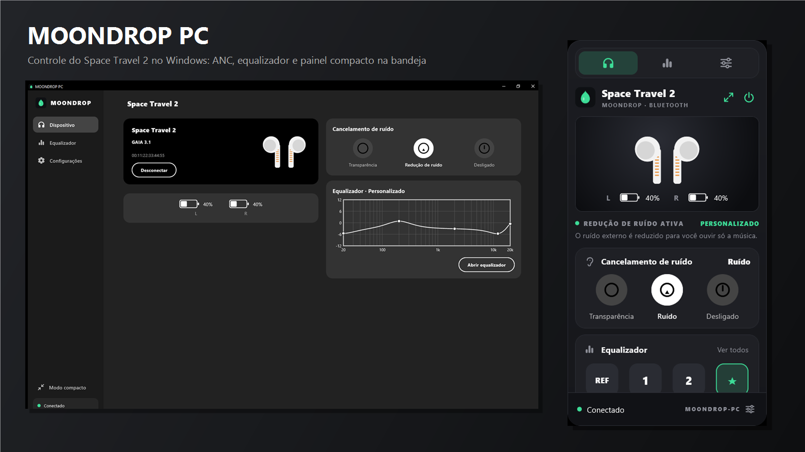
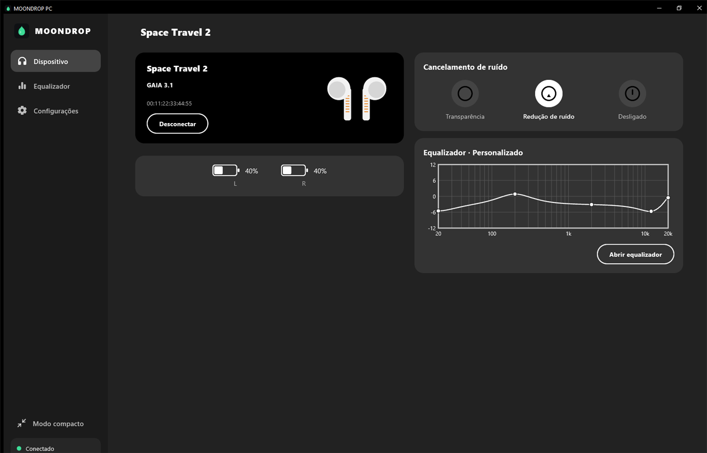
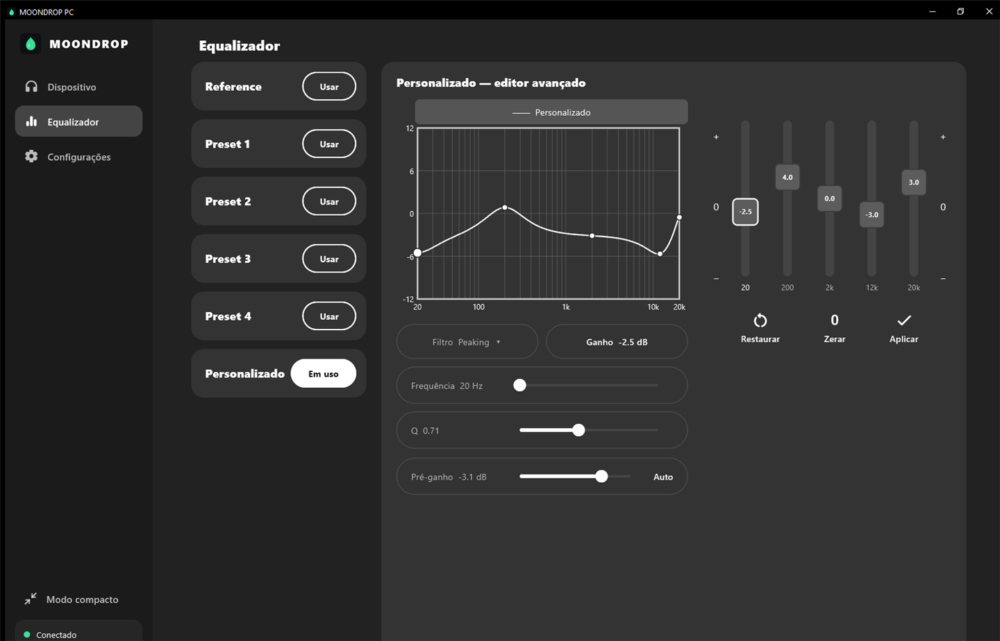
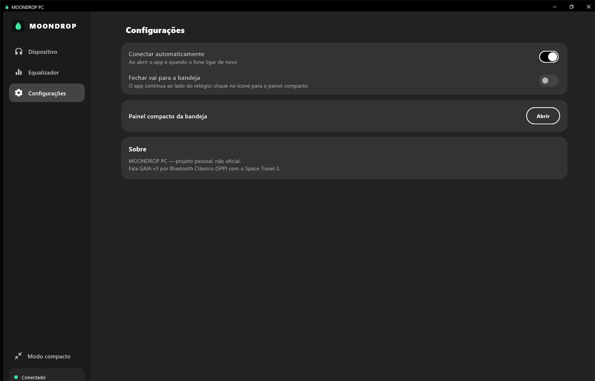
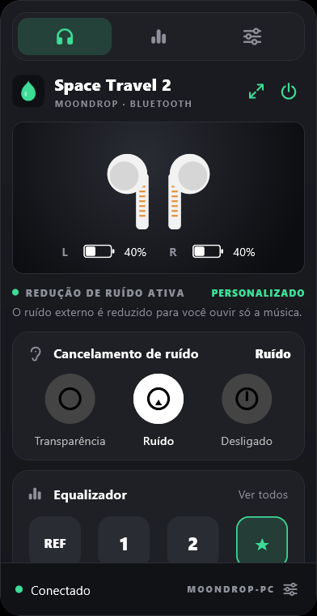
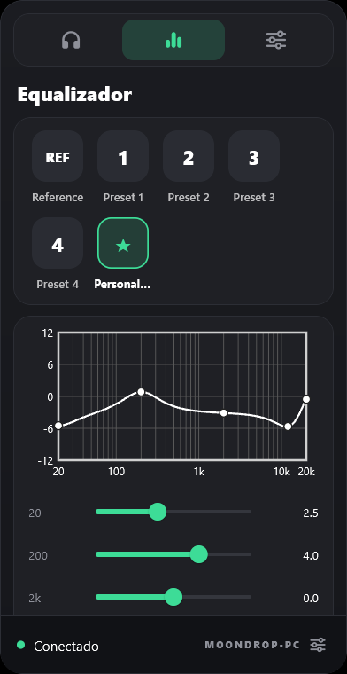

<div align="center">



# MOONDROP PC

**Controle o seu MOONDROP Space Travel 2 direto do Windows.**
Cancelamento de ruído, equalizador com editor avançado e um painel compacto na bandeja do sistema.


[](LICENSE)
[](https://github.com/herikk04/moondrop-pc/releases/latest)

</div>

> **Projeto independente e não oficial.** Não tem relação com a MOONDROP nem com a Qualcomm. "MOONDROP" e "Space Travel 2" são marcas dos seus respectivos donos, citadas aqui apenas para identificar o equipamento compatível.

## Por que existe

O app oficial da MOONDROP só existe para celular. Este projeto leva os controles mais usados do fone para o PC, falando o mesmo protocolo que o app oficial usa, sem precisar do celular.

## Recursos

- **Conexão automática** ao abrir o app e quando o fone ligar de novo (Bluetooth Clássico, perfil SPP).
- **Bateria** dos dois lados.
- **Cancelamento de ruído:** Desligado, Redução de ruído e Transparência.
- **Equalizador:**
  - troca entre os presets do fone;
  - gráfico da curva (20 Hz a 20 kHz);
  - **editor avançado** do preset Personalizado: ganho, frequência e Q de cada uma das 5 bandas, pré-ganho (com ajuste automático) e aplicar/restaurar.
- **Painel compacto na bandeja**, no estilo de popover de barra de menu: um clique no ícone abre, clicar fora fecha.
- **Layout responsivo:** barra lateral e colunas em janela larga; coluna única em janela estreita.
- Opção de **fechar para a bandeja** e de **conectar automaticamente**.

## Capturas de tela

| Dispositivo | Equalizador (editor avançado) |
| :---: | :---: |
|  |  |

| Configurações | Painel compacto da bandeja |
| :---: | :---: |
|  |   |

> Os prints usam o modo demonstração (dados fictícios), sem nenhum fone conectado.

## Instalação

Baixe a última versão em **[Releases](https://github.com/herikk04/moondrop-pc/releases/latest)**:

| Arquivo | Quando usar |
| --- | --- |
| `MOONDROP_PC-vX.Y.Z-Setup.exe` | **Instalador.** Atalho no menu Iniciar, desinstalador e opção de iniciar com o Windows. Instala só para o seu usuário, sem pedir administrador. |
| `MOONDROP_PC-vX.Y.Z-windows.zip` | **Portátil.** Extraia numa pasta e abra o `moondrop_pc.exe`. |

> Os arquivos não são assinados digitalmente, então o Windows pode mostrar o aviso do SmartScreen. Clique em *Mais informações → Executar assim mesmo*.

**Requisitos:** Windows 10 ou 11 (64 bits) com Bluetooth e o [Visual C++ Redistributable 2015-2022 (x64)](https://learn.microsoft.com/cpp/windows/latest-supported-vc-redist), que a maioria dos PCs já tem. Não precisa de .NET nem de Java.

## Como usar

1. **Pareie o fone no Windows** (Configurações → Bluetooth e dispositivos) e deixe-o conectado ao **PC**.
2. **Feche o app MOONDROP no celular.** O fone só aceita **uma conexão desse tipo por vez**: se o celular estiver conectado, o app do PC mostra "connect falhou".
3. Abra o MOONDROP PC. Ele procura os fones pareados e conecta sozinho ao último usado. Na primeira vez, escolha o seu na lista e clique em **Conectar**.
4. Para o painel compacto, clique no ícone da bandeja ou em **Modo compacto**. Botão direito no ícone: *Abrir, Modo compacto, Sair*.

## Compatibilidade

| Item | Situação |
| --- | --- |
| MOONDROP Space Travel 2 | Testado (Windows 10 22H2). |
| Outros modelos MOONDROP com a mesma plataforma (Qualcomm GAIA) | Não testados. Podem funcionar em parte. |
| Atualização de firmware (OTA), contas, EQ da comunidade, DAC gain, ações do toque, volume | Ainda não implementados. |

## Como funciona

O fone fala **GAIA v3**, o protocolo de controle da Qualcomm, por Bluetooth Clássico (SPP/RFCOMM). O app abre esse canal direto pelo Winsock, via FFI do Dart, sem plugins. Os comandos usados e as respostas observadas no hardware estão documentados em [`analise/PROTOCOLO_SPACE_TRAVEL_2_GAIA.md`](analise/PROTOCOLO_SPACE_TRAVEL_2_GAIA.md).

Resumo:

| Função | Feature GAIA | Comandos |
| --- | --- | --- |
| Bateria | 13 | leitura (comando 1) |
| Cancelamento de ruído | 8 (Audio Curation) | ler modo (3), definir modo (4, máscara de bit) |
| Equalizador | 5 (Music Processing) | presets (1, 2, 3), bandas (4, 5), editar bandas do Personalizado (6) |

O painel compacto e o ícone da bandeja são implementados no executável (Win32), sem pacotes extras.

## Compilar a partir do código-fonte

Requisitos: [Flutter](https://docs.flutter.dev/get-started/install/windows/desktop) (canal stable, 3.47) e o Visual Studio 2022 com a carga de trabalho *Desenvolvimento para desktop com C++*.

```powershell
git clone https://github.com/herikk04/moondrop-pc.git
cd moondrop-pc\app
flutter pub get
flutter run -d windows              # desenvolvimento
flutter build windows --release     # gera build\windows\x64\runner\Release\
```

**Modo demonstração** (explorar a interface sem o fone): defina `MOONDROP_DEMO=1` antes de abrir o app. `MOONDROP_TAB=0|1|2` escolhe a aba inicial.

Para gerar o instalador e publicar uma release (requer [Inno Setup 6](https://jrsoftware.org/isinfo.php) e o GitHub CLI): `tools\release.ps1 -Version X.Y.Z -NotesFile notas.md`.

## Estrutura do repositório

```
app/          app Flutter para Windows (código Dart e runner nativo em C++)
analise/      protocolo GAIA do Space Travel 2, confirmado no hardware
prototipo/    scripts Python usados para sondar o fone (BLE e RFCOMM)
installer/    script do instalador (Inno Setup)
tools/        script de release
docs/         imagens do README
```

## Roteiro

- [ ] DAC gain (Low / Middle / High)
- [ ] Ações do toque (ANC ON / OFF / TP) e ordem do ciclo
- [ ] Volume do fone e *Prompt Sound*
- [ ] Iniciar direto na bandeja
- [ ] Nomes dos presets do EQ (vêm do servidor da MOONDROP)

## Aviso

Este software envia comandos ao fone (modo de ruído, equalizador). Use por sua conta e risco. Ele **não** altera o firmware. Os comandos de escrita foram validados comparando com o que o app oficial envia, mas modelos e versões de firmware diferentes podem se comportar de outro jeito.

## Licença

Distribuído sob a licença [MIT](LICENSE). A licença cobre o código deste repositório; as marcas citadas pertencem aos seus donos.
